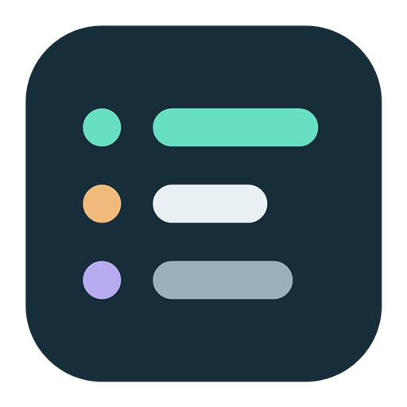

# Session Board

Claude Code·Codex·Google Antigravity의 로컬 Hook 이벤트와 세션 기록을 모아 보는 Windows C++20/luil 앱입니다.

현재 포함된 기능:

- provider별 세션 목록, 제목, 작업 폴더, 모델, 현재 도구, 마지막 활동 시간
- 작업 중·승인 대기·입력 대기·응답 완료·중단·종료·오류 상태
- Codex 원본 Hook 어댑터와 Claude/Codex 공통 정규화 이벤트 입력
- provider 필터(표식과 세션 수만 보이는 칩, 이름은 툴팁), 작업 중 필터, 스크롤, 밝은/어두운 테마
- 기본 화면은 항상 위에 뜨는 간단 위젯이고, 필요할 때 상세 화면을 별도 창으로 함께 띄움
- 위젯 목록 영역의 투명·흐림 배경과 0~100% 진하기 설정, 위젯·상세 화면의 밝게·시스템·어둡게 테마와 키 컬러
- 위젯 목록이 흘러 넘칠 때 위·아래 끝이 옅어지며 사라지는 표시
- Claude·Codex 표식 아이콘
- 한 번에 하나만 실행되는 위젯과 다음 실행에 돌아오는 위젯·상세 창 자리·크기
- 세션이 열린 Claude Code·Codex 창으로 바로 이동 (Hook이 창을 기록한 세션)
- 앱을 닫아도 유지되는 세션별 스냅숏, 동시 쓰기 보호, 1초 내 변경 반영
- 오래된 실행 상태를 완료로 오인하지 않는 `상태 확인 필요` 표시. 열린 세션의 결과 없는 도구는 `작업 중 · 12분째`로, 응답 도중 닫힌 세션은 `세션 종료`로 확정
- Claude API 오류(`StopFailure`, 기록의 API 오류 응답)의 원인 표시: `오류 · 사용 한도 도달` 등

- Claude Code·Codex 로컬 세션 자동 탐색과 앱 시작 시 두 provider의 Hook 자동 등록 ([Claude 연동](docs/claude-integration.md))
- Claude 하위 에이전트·백그라운드 명령을 부모 세션 카드 아래 하위 행으로 표시 ([하위 세션 설계](docs/child-sessions-design.md))
- Antigravity 로컬 대화 자동 탐색 ([Antigravity 연동](docs/antigravity-integration.md)). Hook 등록은 아직 하지 않습니다.

데모(`send-demo.ps1`)의 행은 샘플 이벤트입니다.

## 앱 아이콘



짙은 청록색 보드 위의 세 행과 상태 점으로 여러 AI 세션을 함께 지켜보는 모습을 표현한 자체 제작 아이콘입니다.
원본은 `assets/session-board.svg`이며, `assets/session-board.ico`에는 16~256px의 10개 크기가 들어 있습니다.
아이콘은 실행 파일과 창 아이콘 리소스로 포함됩니다. SVG를 수정한 뒤 Windows PowerShell 7에서 다음 명령으로 PNG·ICO를 다시 만듭니다.

```powershell
./scripts/generate-icon.ps1
```

## 빌드

필요 환경: Windows 11 x64, Visual Studio 2026 또는 2022의 C++ 도구와 Windows SDK 22621 이상, CMake 4.2 이상, PowerShell 7.2 이상.

```powershell
git submodule update --init third_party/luil
git -C third_party/luil submodule update --init third_party/nlohmann_json
./third_party/luil/scripts/fetch_skia.ps1 -Configuration Debug,Release
cmake --preset vs2026
cmake --build --preset vs2026-release --parallel
ctest --preset vs2026-release
cmake --install build/vs2026 --config Release
```

`cmake --install`은 `session-board.exe`를 프로젝트의 `bin/`에 복사합니다. Hook도 같은 실행 파일이 `--hook` 인자로 처리하므로 배포 파일은 이 하나뿐입니다.
제3자 라이선스 고지는 실행 파일 resource에 들어 있고, 상세 화면 제목 표시줄이나 알림 영역 메뉴의 **오픈 소스 라이선스**에서 볼 수 있습니다.
`--prefix <폴더>`로 다른 곳에 설치할 수 있습니다.
설치한 앱을 실행 중이면 파일이 잠겨 덮어쓰지 못하므로 먼저 종료하세요.
Hook 스크립트로 설치본을 등록하려면 `-Executable bin/session-board.exe`를 지정합니다.

VS 2022는 `vs2022`, `vs2022-release` 프리셋을 사용합니다.
기존 Skia 패키지가 있다면 복사하거나 다시 받지 않고 configure 인자로 지정할 수 있습니다.

```powershell
cmake --preset vs2026 -DLUIL_SKIA_ROOT=<Skia 패키지 폴더>
```

초기 luil 빌드는 오래 걸릴 수 있습니다. CPU 렌더러, 정적 CRT를 사용하고 WebView와 Direct3D는 비활성화했습니다.
Hook도 같은 실행 파일이 처리하지만 `--hook` 실행은 창과 luil 화면을 만들지 않고 이벤트 하나만 저장합니다. 기본 설정에는 별도 서비스나 웹 런타임이 필요 없습니다.
서브모듈은 luil 커밋 `c0cb108`(캡션의 위·아래 배치, 창 배치와 frame을 한 합성에 내는 레이어드 표시 포함)에 고정했습니다.

## 실행과 데모

```powershell
./build/vs2026/bin/Release/session-board.exe

# 상세 화면도 처음부터 함께 연다
./build/vs2026/bin/Release/session-board.exe --detail

# 실제 세션 저장소를 건드리지 않는 데모
./scripts/send-demo.ps1
./build/vs2026/bin/Release/session-board.exe --data-dir ./build/demo-sessions
```

기본 데이터 위치는 `%LOCALAPPDATA%/SessionBoard/sessions`입니다.
`--data-dir`로 저장 폴더를 바꿀 수 있습니다. 테스트/샘플은 실제 저장소와 분리하세요.

기본 실행에서는 `%USERPROFILE%/.codex` 또는 `CODEX_HOME`의 **기존 로컬 Codex 세션을 자동 탐색**합니다.
데스크톱·CLI의 세션 기록을 읽기 전용으로 따라가며, 실제로 보유 중인 작성 잠금으로 열린 세션을 구별합니다.
이미 사용 중인 대화도 재시작이나 새 검증 요청 없이 표시합니다. 같은 세션의 Hook 기록은 하나의 카드로 합칩니다.
새 파일 탐색은 최대 5초, 기존 파일의 새 활동은 약 1초 간격으로 반영합니다.

카드 본문은 Codex가 공개한 최근 진행 메시지나 마지막 답변의 첫 문장입니다.
그 아래에는 실제 도구 동작과 작업·승인 대기·입력 대기·응답 완료 상태를 표시합니다.
공개 작업 설명이 없으면 대화 이름 또는 수신 대기를 표시하며, 사용자 요청문을 작업 설명으로 대신 사용하지 않습니다.
비공개 reasoning, 도구 출력, 명령 인자는 표시하거나 별도로 저장하지 않습니다. 추가 AI API 호출도 하지 않습니다.

`--no-codex-discovery`로 자동 탐색을 끄고 Hooks만 사용할 수 있습니다.
`--codex-home <경로>`로 수집할 로컬 Codex 홈을 지정합니다. `--data-dir`를 사용하면 테스트 격리를 위해 자동 탐색을 끄며, `--codex-home`을 함께 주면 지정 경로만 읽습니다.

앱은 위젯으로 시작합니다. 위젯은 테두리와 작업 표시줄 단추 없이 항상 위에 뜨고, 키 컬러로 채운 머릿줄(단추 제외)을 잡아 옮깁니다.
머릿줄을 기준으로 목록이 모니터 작업 영역 아래를 넘으면 위로, 위를 넘으면 아래로 펼쳐집니다. 방향이 바뀌거나 목록을 접고 펼칠 때도 머릿줄의 화면 위치는 유지합니다.
양쪽 모두 공간이 부족하면 더 넓은 쪽에 맞춰 창 높이를 줄이고 목록을 스크롤합니다. 창 너비·높이는 모니터 작업 영역을 넘지 않습니다. 상태 줄은 목록의 반대쪽 끝에 놓입니다.
머릿줄 아이콘으로 상세 화면 열기·닫기, 테마·키 컬러, 배경 효과, 항상 위에 표시, 목록 접기·펼치기, 종료를 조작합니다.
테마 단추를 누르면 목록 영역 위에 설정 줄이 펼쳐져 밝게·시스템·어둡게 미리 보기 카드와 키 컬러를 고릅니다. 시스템은 Windows 앱 모드를 따릅니다. 키 컬러는 위젯 머릿줄과 상세 창에 함께 쓰입니다.
상세 화면은 작업 표시줄에 따로 서는 독립 창이라 위젯과 함께 띄워 둘 수 있습니다. 상세 창을 닫아도 위젯은 남습니다.
배경 효과 단추를 누르면 목록 영역 위에 설정 줄이 펼쳐집니다. `투명`·`흐림`·`Acrylic` 중 하나를 고릅니다. `투명`은 바탕 화면이 그대로 비치고, `흐림`은 창 뒤를 흐리기만 하며, `Acrylic`은 흐린 뒤에 테마 명암에 맞춘 색 막을 덧씌웁니다.
위젯은 레이어드 창이라 Windows 11 시스템 배경 효과가 흐림 없는 단색 판이 되므로, `흐림`과 `Acrylic`은 Windows 비공개 API(`SetWindowCompositionAttribute`)로 겁니다. 이 API가 없는 Windows에서는 둘 다 `투명`처럼 뒤가 그대로 비칩니다.
진하기는 그 위에 까는 목록 영역 바탕(테마의 창 바탕색)의 농도로, 슬라이더를 끌어 0~100%에서 정합니다. 투명에서 0%면 바탕 없이 글만 뜨고, 흐림에서 0%면 흐린 뒤만 보이며, Acrylic에서 0%면 Acrylic 판만 남습니다 — Acrylic은 흐린 뒤에 색 막을 입힌 판이라 0%여도 뒤가 맑게 비치지 않습니다. 100%면 배경과 관계없이 흐림을 끈 불투명 창이 됩니다.
진하기가 0%여도 목록의 빈 자리를 누르면 뒤 창이 아니라 위젯이 받습니다.
끌면 0·10·25·50·75·100%에 자석처럼 붙고, Ctrl을 누른 채 끌면 붙지 않고 세밀하게 맞춥니다.
테마·키 컬러·흐림·진하기는 `%LOCALAPPDATA%/SessionBoard/appearance-release.json`(Debug는 `appearance-debug.json`)에 저장해 다음 실행에 그대로 엽니다. 바뀐 값은 1초 안에, 그리고 종료할 때 씁니다. `--data-dir`로 연 실행은 이 파일을 읽지도 쓰지도 않습니다.
목록을 접으면 머릿줄만 남습니다. 목록이 아래로 펼쳐지면 오른쪽 아래, 위로 펼쳐지면 오른쪽 위 모서리를 끌어 크기를 조절합니다.
목록을 접으면 사용자 승인·입력이 필요한 세션과 하위 작업을 알림으로 계속 표시합니다. 작업 중이던 세션의 응답이 끝나거나 오류로 멈추면 `작업 끝남` 알림을 띄웁니다. 요청 발췌문이 있으면 요청을 제목으로, 결과 문장을 아랫줄로 보여 무엇을 요청했고 어떻게 끝났는지 알리고, 오류면 원인을 보입니다. 이 알림은 저절로 사라지지 않고 카드의 체크 단추를 누르거나 그 세션이 다시 일을 시작하거나 목록을 펼치면 사라집니다. 사용자가 중단했거나 세션이 닫힌 것, 처음 볼 때 이미 끝나 있던 세션, 진행 갱신은 알리지 않습니다. 알림 카드에도 목록 카드와 같은 세션 창 이동 단추가 있어 목록을 펼치지 않고 그 세션으로 갈 수 있습니다. 이동하지 못하면 이유를 알림 머리에 잠시 보입니다.
응답이 필요할 때는 알림을 읽거나 마우스를 올려도 지워지지 않습니다. 외부 세션에서 응답을 처리하면 마지막 요청을 `응답 처리됨`으로 잠시 표시한 뒤 8초 후 숨깁니다. 이어지는 작업 중 상태나 진행 메시지를 새 알림으로 띄우지 않습니다.
여러 대기 항목은 스크롤할 수 있습니다. 목록을 펼쳤다가 다시 접어도 아직 응답이 필요한 항목은 다시 나타나며, 목록을 보고 있을 때는 기존처럼 목록만 갱신됩니다.
위젯은 luil의 레이어드 표시로 띄워, 크기가 바뀌면 그 크기로 다시 배치한 화면과 창 위치·크기를 한 번에 바꿉니다. 아래쪽 머릿줄을 둔 채 접고 펼쳐도 머릿줄이 한 프레임도 다른 자리에 보이지 않습니다.

위젯은 한 번에 하나만 실행됩니다. 이미 떠 있을 때 다시 실행하면 새 창을 만들지 않고 떠 있는 위젯을 앞으로 가져옵니다.
Debug·Release 빌드와 `--data-dir`로 연 테스트 실행은 서로 막지 않고 따로 뜹니다.
위젯을 옮기거나 크기를 바꾸면 그 자리와 크기를 `%LOCALAPPDATA%/SessionBoard/widget-release.json`(Debug는 `widget-debug.json`)에 기억해 다음 실행에 그대로 엽니다.
접은 채 닫아도 펼친 크기를 기억합니다. `--position=x,y`를 주거나 `--data-dir`로 연 실행은 기억한 자리를 쓰지 않고, `--data-dir` 실행은 자리를 저장하지도 않습니다.
상세 창도 같은 폴더의 `detail-release.json`(Debug는 `detail-debug.json`)에 마지막 자리·크기와 최대화 여부를 기억해, 닫았다 다시 열 때와 다음 실행에 그 자리로 엽니다.
Claude·Codex 이름 앞의 표식은 상표라 아이콘 글꼴에 없어 Simple Icons(CC0)의 SVG 경로를 Skia로 직접 그립니다. Simple Icons에 Codex 표식이 없어 Codex에는 OpenAI 표식을 씁니다.
각 카드에는 AI 종류, 작업 폴더, 상태, 현재 작업 설명, 실제 도구 동작과 마지막 활동 시간이 표시됩니다.
카드 오른쪽 위의 이동 단추는 그 세션이 열린 터미널이나 데스크톱 앱 창을 앞으로 가져옵니다. Hook이 창을 기록하지 못한 세션(로컬 기록으로만 수집한 세션 등)은 단추가 꺼져 있습니다.
Claude 데스크톱 앱(Code 탭)에서 연 세션은 창 대신 `claude://code/continue?session=local_…` 주소로 그 세션 화면을 바로 엽니다.
데스크톱 세션 ID(`local_…`)는 데스크톱의 세션 기록(`claude-code-sessions/…/local_*.json`)의 `cliSessionId`로 Claude Code 세션 ID와 잇습니다. 보관한 세션은 창 이동으로 물러섭니다.
Codex 앱에서 연 스레드(로컬 기록의 `originator`가 `Codex Desktop`)는 `codex://threads/<스레드 ID>`로 그 스레드를 엽니다. 터미널(`codex-tui`) 세션은 창 이동을 씁니다.
카드는 제품을 표식으로만 보이고 이름 글은 붙이지 않습니다. 카드에 포인터를 잠시 두면 위젯을 덮지 않는 쪽 옆에 요청·결과·하위 작업·작업 폴더·세션 ID를 담은 세부 정보 팝업이 뜹니다. 목록을 접은 동안의 알림 카드도 같습니다. 양옆에 자리가 없으면 띄우지 않습니다. 카드를 누르면 전체 설명과 대화 이름·수집 출처·작업 폴더·세션 ID를 카드 안에 펼칩니다. Hook에 요청 발췌문이 있으면 세부 정보 팝업·펼친 카드와 접힌 위젯의 `작업 끝남` 알림에서만 표시합니다.
진행 중인 세션을 우선 표시하고, 열린 Codex 세션은 응답이 끝나도 유지합니다. 닫힌 세션의 최근 활동은 15분간 유지합니다. `최근 완료 · 종료` 묶음의 정리 단추를 누르면 그 묶음을 비우고, 정리한 세션은 새 소식이 오면 다시 나타납니다. 정리는 위젯에만 적용되며 상세 화면 목록은 그대로입니다. 접힌 위젯의 알림 머리에 있는 단추는 응답을 기다리지 않는 알림을 한꺼번에 숨깁니다.
하단에는 provider별 마지막 이벤트 수신 시각을 표시합니다. 수신 없음과 진행 중인 세션 없음도 구분합니다.

## Codex Hook 등록

일반 실행에서는 앱이 **Codex Hook을 자동 등록**합니다. 배포 파일은 `session-board.exe` 하나입니다.
앱 자신을 `%LOCALAPPDATA%/SessionBoard/bin`에 복사하고 `CODEX_HOME` 또는 `%USERPROFILE%/.codex`의 `hooks.json`에 `session-board.exe --hook --provider codex` 8개 항목을 넣습니다.
예전 `session-board-hook.exe` 항목은 새 명령으로 바꿔 끼우므로, 업데이트 뒤 Codex의 `/hooks`에서 한 번 다시 신뢰해야 합니다.
기존 설정·다른 Hook을 보존하고 변경 전 `.bak`을 만듭니다. 정의가 같으면 설정 파일을 쓰지 않아 기존 신뢰 상태도 유지합니다.
복사본이 없거나 교체에 실패하면 설정을 바꾸지 않고 하단에 등록 오류를 표시합니다. 로컬 세션 탐색은 계속됩니다.

새 환경에서는 등록 후 **Codex의 `/hooks`에서 최초 신뢰 검토**가 필요합니다. 앱은 신뢰 설정을 대신 쓰지 않습니다.
새로 등록했을 때 하단에 `/hooks 신뢰 필요`를 표시합니다. `Hooks 등록됨`은 설정 파일 등록 결과이며 신뢰 상태를 조회한 결과는 아닙니다.
로컬 자동 탐색으로는 신뢰 검토 전에도 이미 열린 세션이 표시됩니다.

`--no-codex-hooks`는 자동 등록만 끕니다. `--data-dir`·`--codex-home`·`--no-codex-discovery`를 준 실행도 Codex 설정을 바꾸지 않습니다.
수동 Preview·등록도 지원합니다.

```powershell
./scripts/install-codex-hooks.ps1 -Preview
./scripts/install-codex-hooks.ps1
```

기존 `~/.codex/hooks.json`의 다른 Hook을 보존하고 Session Board 항목만 추가합니다.
`CODEX_HOME`을 사용 중이면 그 경로를 따릅니다. 실행 파일은 `%LOCALAPPDATA%/SessionBoard/bin`에 복사합니다.
원본 설정은 날짜가 붙은 `.bak`으로 백업합니다. 반복 실행해도 같은 항목이 중복되지 않습니다.

설치 후 **Codex에서 `/hooks`를 열어 추가된 Hook을 검토하고 신뢰 처리**하세요.
데스크톱은 Hook 신뢰 UI를 통해 같은 검토를 해야 합니다. 신뢰 절차를 자동으로 우회하지 않습니다.
Hook 경로는 등록과 신뢰 처리를 반영한 Codex 세션에서 이후 발생한 이벤트를 수집합니다.

```powershell
# Hook 항목을 제거하고 앱의 Codex 자동 등록도 끕니다. 다른 설정과 저장 데이터는 보존합니다.
./scripts/install-codex-hooks.ps1 -Remove
```

제거 시 `%LOCALAPPDATA%/SessionBoard/codex-hooks.disabled`를 만들며, 스크립트로 다시 설치하면 이 표시를 지웁니다.

Hooks만 사용하면 설치·신뢰 처리 전에 실행 중이던 세션은 이후 이벤트가 있어야 표시됩니다. 기본 로컬 자동 탐색은 이미 열린 Codex 세션도 발견합니다.
응답 종료는 작업 성공을 뜻하지 않으며 정확한 진행률/남은 시간을 표시하지 않습니다.
WSL/원격/클라우드에서 실행되는 Hook은 이 Windows 저장소로 전달할 별도 어댑터가 필요합니다.
자세한 상태 의미와 한계는 [이벤트 규격](docs/event-protocol.md)을 참고하세요.

## Claude Code 연동

기본 실행에서는 `CLAUDE_CONFIG_DIR` 또는 `%USERPROFILE%/.claude`의 **이미 열린 Claude Code 세션을 자동 탐색**합니다.
실행 중 세션 등록 정보(`sessions/<pid>.json`)를 실제 프로세스 생성 시각과 대조해 열린 세션을 구별하고, transcript의 추가분에서 공개 진행 메시지와 도구 동작을 읽습니다.

앱을 열면 Claude Hook도 **자동으로 등록**합니다. 같은 복사본을 `session-board.exe --hook --provider claude`로 `settings.json`에 Session Board 항목만 넣습니다.
이미 등록되어 있으면 파일을 쓰지 않고, 바꿀 때는 `.bak`으로 백업합니다. 다른 설정과 Hook은 보존합니다. Claude Code는 실행 중인 세션에도 변경을 반영합니다.

```powershell
# 추가될 항목 확인, 수동 설치, 제거(앱의 자동 등록도 끕니다)
./scripts/install-claude-hooks.ps1 -Preview
./scripts/install-claude-hooks.ps1
./scripts/install-claude-hooks.ps1 -Remove
```

`--no-claude-hooks`는 자동 등록만, `--no-claude-discovery`는 Claude 수집 전체를 끕니다. `--claude-home <경로>`로 읽을 Claude 홈을 지정합니다.
`--data-dir`나 `--claude-home`을 준 실행은 실제 Claude 설정을 바꾸지 않습니다. 자세한 근거와 한계는 [Claude 연동](docs/claude-integration.md)을 참고하세요.

## Antigravity 연동

기본 실행에서는 `%USERPROFILE%/.gemini` 아래 `antigravity`·`antigravity-ide`·`antigravity-cli` 폴더의 **이미 열린 Antigravity 대화를 자동 탐색**합니다.
앱이 실제로 잠가 둔 `presence/<대화 ID>.lock`으로 열린 대화를 구별하고, `brain/<대화 ID>/.system_generated/logs/transcript.jsonl`의 추가분에서 공개 진행 메시지와 도구 동작을 읽습니다.
대화 이름은 `annotations/<대화 ID>.pbtxt`에서, 작업 폴더는 도구 인자의 경로와 `config/projects/*.json`의 프로젝트 루트를 맞춰 찾습니다. SQLite DB는 열지 않습니다.
`presence`가 없는 제품(IDE)의 기록은 최근 기록으로만 15분간 보입니다. 비공개 `thinking`, 명령 인자, 도구 출력은 표시하지 않습니다.

아직 Hook은 등록하지 않습니다. 그래서 승인 대기는 구별하지 못하고 `작업 중`으로 보이며, 창 이동 단추는 꺼져 있습니다.
`--no-antigravity-discovery`로 수집을 끄고, `--antigravity-home <경로>`로 읽을 홈을 지정합니다. `--data-dir`만 준 실행은 실제 Antigravity 홈을 읽지 않습니다.

## 검사

```powershell
./scripts/format.ps1
./scripts/format.ps1 -check
./scripts/check_source_style.ps1
ctest --preset vs2026-release
```

포맷은 clang-format 22를 사용합니다. VS 2026의 C++ Clang 도구에서도 찾습니다.
테스트는 provider 분리, 상태 전이, 오래된 이벤트, UTF-8 제목, 병렬 저장, 손상 파일 격리와 Antigravity 기록·잠금·대화 이름·작업 폴더 해석을 확인합니다.
빌드 출력에는 luil 리소스의 제3자 고지와 Hook의 nlohmann/json 고지가 포함됩니다.

선택적인 `tests/ui-smoke.ps1`은 설치된 `luil-uia` 스킬 도우미를 사용합니다.
앱을 따로 만든 데스크톱에 띄워 사용 중인 화면의 포커스·커서를 건드리지 않습니다. 위젯으로 시작해 상세 창 열고 닫기, 실시간 수신, 승인 대기, 필터, 응답 종료, 테마·키 컬러, 진하기 0%·100%, 배경 효과, 위젯 접기·고정, 세션 이동 단추 상태, 스크롤을 검증하고 테스트 앱을 닫습니다.
`-UiaScript`로 도우미 경로를 지정할 수 있으며 CTest의 필수 환경에는 포함하지 않습니다.

```powershell
./tests/ui-smoke.ps1
./tests/widget-layout-smoke.ps1
./tests/hook-startup.ps1
```

`tests/hook-startup.ps1`은 별도 Codex·Claude 설정 폴더와 격리 데스크톱에서 앱을 두 번 실행합니다.
최초 자동 등록, 다른 설정·Hook 보존, 반복 실행 시 설정 파일 미수정을 확인합니다. 실제 사용자 설정은 변경하지 않으며 공용 복사본만 최신 빌드로 갱신합니다.

`tests/widget-layout-smoke.ps1`은 별도 데이터 폴더와 `luil-uia` 격리 데스크톱에서 머릿줄의 위·아래 전환과 접기·펼치기의 좌표 유지, 끌기·단추 판정, 작업 영역 크기 제한, 갱신 알림의 위치·확인·스크롤·목록 전환과 작업 끝남 알림의 표시·닫기를 검증합니다. 사용 중인 데스크톱의 포커스·커서를 변경하지 않습니다. 테스트 화면과 `verification.json`은 `build/widget-layout-*/`에 저장하고 테스트 앱과 격리 데스크톱을 정리합니다. 실행 중인 설치본과 함께 검사할 수 있습니다.
이 검사는 배치 좌표를 봅니다. 전환 중 DWM이 합성한 화면은 격리 데스크톱과 창 DC로 볼 수 없으므로 `tests/widget-header-flash.ps1`이 따로 잽니다.

`tests/widget-header-flash.ps1`은 사용 중인 데스크톱에 별도 데이터 폴더로 테스트 위젯을 잠시 띄워 아래쪽 머릿줄을 접고 펼치며 화면을 연속 캡처합니다. 머릿줄 색이 제자리가 아닌 곳에 보인 프레임이 있으면 실패합니다. 실제 위젯 자리·외형·Hook 설정은 바꾸지 않으며, 결과와 실패 화면은 `build/widget-flash-*/`에 남깁니다. 실행 중에는 위젯을 가리지 않게 해 주세요.

`scripts/verify-codex-live.ps1 -RunTurn`은 신뢰 처리된 실제 Codex 런타임에 일회성 읽기 전용 요청을 보냅니다.
기존 Codex 인증을 사용해 실제 모델 요청 1회를 실행하며 사용자 파일은 수정하지 않습니다.
자동 CTest에는 포함하지 않고 결과는 `build/live-codex-verification.json`에 남깁니다.
실행 중인 위젯의 PID를 `-AppProcessId`로 주면 같은 실제 세션의 요청 내용과 실행·도구 호출·응답 완료·세션 종료를 UIA로 검증하고 단계별 캡처도 저장합니다.
검증 후 위젯은 볼 수 있는 상태로 남깁니다. `tests/widget-window-smoke.ps1 -AppProcessId <PID>`는 캡션의 빈 부분을 실제 포인터로 끌어 이동을 검증한 뒤 위치와 커서를 복원합니다.
`scripts/verify-current-session.ps1 -AppProcessId <PID> -ThreadId <대화 ID> -ExpectedProgress <공개 진행 메시지>`는 새 AI 세션을 만들지 않고 현재 대화의 ID·작업 설명·상태를 실제 위젯과 대조합니다.
결과와 화면은 `build/current-session-verification.json`, `build/current-codex-session.png`에 남깁니다.
